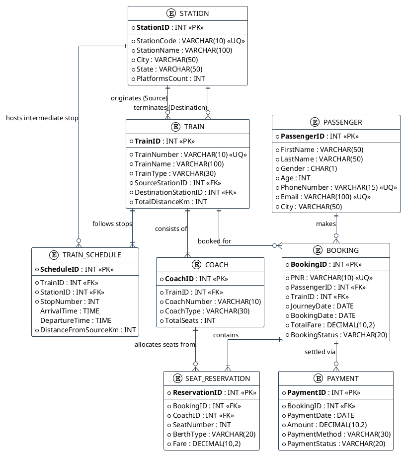

# 🚆 Railway Management System (RMS) — Database System Specification

[](#)
[](#)
[](#)
[](#)

A comprehensive, production-grade relational database design and implementation for an enterprise **Railway Management System (RMS)**. This repository provides an end-to-end database solution including conceptual modeling (**PlantUML ERD**), logical schema specifications (**3NF/BCNF**), **20 diverse SQL queries with verified execution outputs**, and **formal Relational Algebra queries**.

---

## 📑 Table of Contents
1. [Project Overview](#-project-overview)
2. [Entity-Relationship (ER) Diagram](#-entity-relationship-er-diagram)
3. [Relational Schemas & Normalization](#-relational-schemas--normalization)
4. [Database DDL & Integrity Constraints](#-database-ddl--integrity-constraints)
5. [20 SQL Queries & Verified Outputs](#-20-sql-queries--verified-outputs)
6. [Formal Relational Algebra Queries](#-formal-relational-algebra-queries)
7. [Quickstart & Execution Guide](#-quickstart--execution-guide)
8. [Project File Structure](#-project-file-structure)

---

## 🎯 Project Overview

The **Railway Management System (RMS)** manages nation-wide passenger rail operations, handling high-volume transactional workloads, ticket reservations, route scheduling, seat allocation, and revenue settlement.

### Key Domain Capabilities:
- **Station Network:** Management of junction points, codes, terminal cities, and platform allocations.
- **Train & Scheduling:** Express, Superfast, Mail, and Rajdhani train classes with ordered multi-stop itineraries and cumulative distance tracking.
- **Coach & Seating:** Class-specific coach configurations (AC 1-Tier, 2-Tier, 3-Tier, Sleeper) with berth assignments (`Lower`, `Middle`, `Upper`, `Side Lower`, `Cabin`).
- **Passenger & Booking Engine:** Unique PNR generation, journey date validation, status management (`Confirmed`, `Waiting`, `Cancelled`).
- **Financial Settlement:** Multi-channel payment auditing (`Credit Card`, `Debit Card`, `UPI`, `Net Banking`) with transaction states (`Success`, `Refunded`, `Failed`).

---

## 📐 Entity-Relationship (ER) Diagram

### PlantUML Source Code (`ERD.puml`)
The ER diagram is modeled using standard Crow's Foot notation. You can preview it directly in VS Code, IntelliJ, or paste it into [PlantText](https://www.planttext.com/).



### Cardinality Specifications:
| Relationship | Multiplicity | Description |
|---|---|---|
| **Station $\to$ Train (Source)** | $1 : N$ | A station acts as an origin for zero or many trains; each train has exactly one origin station. |
| **Station $\to$ Train (Destination)** | $1 : N$ | A station acts as a terminus for zero or many trains; each train has exactly one destination. |
| **Train $\to$ TrainSchedule** | $1 : N$ | A train itinerary has multiple ordered stops ($StopNumber \ge 1$). |
| **Train $\to$ Coach** | $1 : N$ | A train consists of one or more physical carriages. |
| **Passenger $\to$ Booking** | $1 : N$ | A passenger can create multiple historical and future bookings. |
| **Booking $\to$ SeatReservation** | $1 : N$ | A booking can hold one or multiple confirmed seat reservations. |
| **Coach $\to$ SeatReservation** | $1 : N$ | A coach accommodates multiple seat allocations. |
| **Booking $\to$ Payment** | $1 : N$ | A booking has one or more financial ledger entries (debit, refund, retry). |

---

## 🗃 Relational Schemas & Normalization

### Formal Schema Notation
- $\text{Station}(\underline{\text{StationID}}, \text{StationCode}, \text{StationName}, \text{City}, \text{State}, \text{PlatformsCount})$
- $\text{Train}(\underline{\text{TrainID}}, \text{TrainNumber}, \text{TrainName}, \text{TrainType}, \textit{SourceStationID}, \textit{DestinationStationID}, \text{TotalDistanceKm})$
- $\text{TrainSchedule}(\underline{\text{ScheduleID}}, \textit{TrainID}, \textit{StationID}, \text{StopNumber}, \text{ArrivalTime}, \text{DepartureTime}, \text{DistanceFromSourceKm})$
- $\text{Coach}(\underline{\text{CoachID}}, \textit{TrainID}, \text{CoachNumber}, \text{CoachType}, \text{TotalSeats})$
- $\text{Passenger}(\underline{\text{PassengerID}}, \text{FirstName}, \text{LastName}, \text{Gender}, \text{Age}, \text{PhoneNumber}, \text{Email}, \text{City})$
- $\text{Booking}(\underline{\text{BookingID}}, \text{PNR}, \textit{PassengerID}, \textit{TrainID}, \text{JourneyDate}, \text{BookingDate}, \text{TotalFare}, \text{BookingStatus})$
- $\text{SeatReservation}(\underline{\text{ReservationID}}, \textit{BookingID}, \textit{CoachID}, \text{SeatNumber}, \text{BerthType}, \text{Fare})$
- $\text{Payment}(\underline{\text{PaymentID}}, \textit{BookingID}, \text{PaymentDate}, \text{Amount}, \text{PaymentMethod}, \text{PaymentStatus})$

### Normal Form Justification:
1. **1NF (Atomic Attributes):** Every cell holds a single atomic value. No repeating groups or composite lists (such as comma-separated phone numbers or berths).
2. **2NF (No Partial Dependencies):** Every relation is in 1NF, and all non-key attributes are fully functionally dependent on the primary key. In entities with candidate composite keys (such as `TrainSchedule`), surrogate primary keys are paired with `UNIQUE (TrainID, StopNumber)` constraints.
3. **3NF / BCNF (No Transitive Dependencies):** No non-prime attribute determines another non-prime attribute ($X \to Y \to Z$ eliminated). Station geographic attributes are isolated in `Station`; passenger communication channels are in `Passenger`; fare and payment auditing records are decoupled from seat records.

---

## 💾 Database DDL & Integrity Constraints

All tables include strict referential integrity rules (`ON DELETE CASCADE` / `ON DELETE RESTRICT`) and domain-level `CHECK` constraints:

```sql
-- STATION TABLE
CREATE TABLE Station (
    StationID INTEGER PRIMARY KEY,
    StationCode VARCHAR(10) NOT NULL UNIQUE,
    StationName VARCHAR(100) NOT NULL,
    City VARCHAR(50) NOT NULL,
    State VARCHAR(50) NOT NULL,
    PlatformsCount INTEGER NOT NULL CHECK (PlatformsCount > 0)
);

-- TRAIN TABLE
CREATE TABLE Train (
    TrainID INTEGER PRIMARY KEY,
    TrainNumber VARCHAR(10) NOT NULL UNIQUE,
    TrainName VARCHAR(100) NOT NULL,
    TrainType VARCHAR(30) NOT NULL CHECK (TrainType IN ('Express', 'Superfast', 'Passenger', 'Mail', 'Rajdhani')),
    SourceStationID INTEGER NOT NULL,
    DestinationStationID INTEGER NOT NULL,
    TotalDistanceKm INTEGER NOT NULL CHECK (TotalDistanceKm > 0),
    FOREIGN KEY (SourceStationID) REFERENCES Station(StationID) ON DELETE RESTRICT,
    FOREIGN KEY (DestinationStationID) REFERENCES Station(StationID) ON DELETE RESTRICT
);

-- TRAIN SCHEDULE TABLE
CREATE TABLE TrainSchedule (
    ScheduleID INTEGER PRIMARY KEY,
    TrainID INTEGER NOT NULL,
    StationID INTEGER NOT NULL,
    StopNumber INTEGER NOT NULL CHECK (StopNumber > 0),
    ArrivalTime TIME,
    DepartureTime TIME,
    DistanceFromSourceKm INTEGER NOT NULL CHECK (DistanceFromSourceKm >= 0),
    FOREIGN KEY (TrainID) REFERENCES Train(TrainID) ON DELETE CASCADE,
    FOREIGN KEY (StationID) REFERENCES Station(StationID) ON DELETE RESTRICT,
    UNIQUE (TrainID, StopNumber)
);

-- COACH TABLE
CREATE TABLE Coach (
    CoachID INTEGER PRIMARY KEY,
    TrainID INTEGER NOT NULL,
    CoachNumber VARCHAR(10) NOT NULL,
    CoachType VARCHAR(30) NOT NULL CHECK (CoachType IN ('AC 1-Tier', 'AC 2-Tier', 'AC 3-Tier', 'Sleeper', 'General')),
    TotalSeats INTEGER NOT NULL CHECK (TotalSeats > 0),
    FOREIGN KEY (TrainID) REFERENCES Train(TrainID) ON DELETE CASCADE,
    UNIQUE (TrainID, CoachNumber)
);

-- PASSENGER TABLE
CREATE TABLE Passenger (
    PassengerID INTEGER PRIMARY KEY,
    FirstName VARCHAR(50) NOT NULL,
    LastName VARCHAR(50) NOT NULL,
    Gender CHAR(1) NOT NULL CHECK (Gender IN ('M', 'F', 'O')),
    Age INTEGER NOT NULL CHECK (Age >= 0 AND Age <= 120),
    PhoneNumber VARCHAR(15) NOT NULL UNIQUE,
    Email VARCHAR(100) NOT NULL UNIQUE,
    City VARCHAR(50) NOT NULL
);

-- BOOKING TABLE
CREATE TABLE Booking (
    BookingID INTEGER PRIMARY KEY,
    PNR VARCHAR(10) NOT NULL UNIQUE,
    PassengerID INTEGER NOT NULL,
    TrainID INTEGER NOT NULL,
    JourneyDate DATE NOT NULL,
    BookingDate DATE NOT NULL,
    TotalFare DECIMAL(10,2) NOT NULL CHECK (TotalFare >= 0),
    BookingStatus VARCHAR(20) NOT NULL CHECK (BookingStatus IN ('Confirmed', 'Waiting', 'Cancelled')),
    FOREIGN KEY (PassengerID) REFERENCES Passenger(PassengerID) ON DELETE RESTRICT,
    FOREIGN KEY (TrainID) REFERENCES Train(TrainID) ON DELETE RESTRICT
);

-- SEAT RESERVATION TABLE
CREATE TABLE SeatReservation (
    ReservationID INTEGER PRIMARY KEY,
    BookingID INTEGER NOT NULL,
    CoachID INTEGER NOT NULL,
    SeatNumber INTEGER NOT NULL CHECK (SeatNumber > 0),
    BerthType VARCHAR(20) NOT NULL CHECK (BerthType IN ('Lower', 'Middle', 'Upper', 'Side Lower', 'Side Upper', 'Chair', 'Cabin')),
    Fare DECIMAL(10,2) NOT NULL CHECK (Fare >= 0),
    FOREIGN KEY (BookingID) REFERENCES Booking(BookingID) ON DELETE CASCADE,
    FOREIGN KEY (CoachID) REFERENCES Coach(CoachID) ON DELETE RESTRICT,
    UNIQUE (CoachID, SeatNumber)
);

-- PAYMENT TABLE
CREATE TABLE Payment (
    PaymentID INTEGER PRIMARY KEY,
    BookingID INTEGER NOT NULL,
    PaymentDate DATE NOT NULL,
    Amount DECIMAL(10,2) NOT NULL CHECK (Amount >= 0),
    PaymentMethod VARCHAR(30) NOT NULL CHECK (PaymentMethod IN ('Credit Card', 'Debit Card', 'UPI', 'Net Banking')),
    PaymentStatus VARCHAR(20) NOT NULL CHECK (PaymentStatus IN ('Success', 'Failed', 'Refunded')),
    FOREIGN KEY (BookingID) REFERENCES Booking(BookingID) ON DELETE CASCADE
);
```

---

## 📊 20 SQL Queries & Verified Outputs

All queries below were tested and verified against the sample database.

### Q1: Selection, Filtering & Sorting
```sql
SELECT TrainNumber, TrainName, TrainType, TotalDistanceKm
FROM Train
WHERE TotalDistanceKm > 1000
ORDER BY TotalDistanceKm DESC;
```
**Output:**
| TrainNumber | TrainName | TrainType | TotalDistanceKm |
|---|---|---|---|
| 12621 | Tamil Nadu Express | Superfast | 2184 |
| 12301 | Howrah Rajdhani | Rajdhani | 1450 |
| 12951 | Mumbai Rajdhani Express | Rajdhani | 1386 |
| 16533 | Bangalore Mail | Mail | 1010 |

---

### Q2: Multi-Table Inner Join
```sql
SELECT 
    t.TrainNumber,
    t.TrainName,
    t.TrainType,
    s_src.StationName AS SourceStation,
    s_dst.StationName AS DestinationStation,
    t.TotalDistanceKm
FROM Train t
INNER JOIN Station s_src ON t.SourceStationID = s_src.StationID
INNER JOIN Station s_dst ON t.DestinationStationID = s_dst.StationID
ORDER BY t.TrainNumber;
```
**Output:**
| TrainNumber | TrainName | TrainType | SourceStation | DestinationStation | TotalDistanceKm |
|---|---|---|---|---|---|
| 12002 | Bhopal Shatabdi | Superfast | New Delhi Railway Station | Kanpur Central | 440 |
| 12301 | Howrah Rajdhani | Rajdhani | Howrah Junction | New Delhi Railway Station | 1450 |
| 12621 | Tamil Nadu Express | Superfast | Chennai Central | New Delhi Railway Station | 2184 |
| 12951 | Mumbai Rajdhani Express | Rajdhani | New Delhi Railway Station | Mumbai Central | 1386 |
| 12958 | Swarna Jayanti Rajdhani | Rajdhani | Ahmedabad Junction | New Delhi Railway Station | 935 |
| 16533 | Bangalore Mail | Mail | Bengaluru City Junction | Pune Junction | 1010 |

---

### Q3: Aggregation with `GROUP BY`
```sql
SELECT 
    t.TrainNumber,
    t.TrainName,
    COUNT(b.BookingID) AS TotalBookings,
    SUM(b.TotalFare) AS ConfirmedRevenue
FROM Train t
INNER JOIN Booking b ON t.TrainID = b.TrainID
WHERE b.BookingStatus = 'Confirmed'
GROUP BY t.TrainID, t.TrainNumber, t.TrainName
ORDER BY ConfirmedRevenue DESC;
```
**Output:**
| TrainNumber | TrainName | TotalBookings | ConfirmedRevenue |
|---|---|---|---|
| 12951 | Mumbai Rajdhani Express | 4 | 12200 |
| 12301 | Howrah Rajdhani | 2 | 6050 |
| 12621 | Tamil Nadu Express | 1 | 2900 |
| 12002 | Bhopal Shatabdi | 2 | 1900 |
| 12958 | Swarna Jayanti Rajdhani | 1 | 1650 |
| 16533 | Bangalore Mail | 1 | 650 |

---

### Q4: Group Filtering with `HAVING`
```sql
SELECT 
    t.TrainNumber,
    t.TrainName,
    SUM(b.TotalFare) AS TotalRevenue
FROM Train t
INNER JOIN Booking b ON t.TrainID = b.TrainID
WHERE b.BookingStatus = 'Confirmed'
GROUP BY t.TrainID, t.TrainNumber, t.TrainName
HAVING SUM(b.TotalFare) > 5000;
```
**Output:**
| TrainNumber | TrainName | TotalRevenue |
|---|---|---|
| 12951 | Mumbai Rajdhani Express | 12200 |
| 12301 | Howrah Rajdhani | 6050 |

---

### Q5: Left Outer Join (Unused / Isolated Terminals)
```sql
SELECT 
    s.StationID,
    s.StationCode,
    s.StationName,
    s.City,
    s.State
FROM Station s
LEFT JOIN Train t_src ON s.StationID = t_src.SourceStationID
LEFT JOIN Train t_dst ON s.StationID = t_dst.DestinationStationID
WHERE t_src.TrainID IS NULL AND t_dst.TrainID IS NULL;
```
**Output:**
| StationID | StationCode | StationName | City | State |
|---|---|---|---|---|
| 6 | JP | Jaipur Junction | Jaipur | Rajasthan |
| 9 | BSB | Varanasi Junction | Varanasi | Uttar Pradesh |
| 11 | GHY | Guwahati Junction | Guwahati | Assam |

---

### Q6: Subquery with `IN`
```sql
SELECT 
    PassengerID,
    FirstName || ' ' || LastName AS FullName,
    PhoneNumber,
    City
FROM Passenger
WHERE PassengerID IN (
    SELECT DISTINCT b.PassengerID
    FROM Booking b
    INNER JOIN Train t ON b.TrainID = t.TrainID
    WHERE t.TrainType = 'Rajdhani'
)
ORDER BY PassengerID;
```
**Output:**
| PassengerID | FullName | PhoneNumber | City |
|---|---|---|---|
| 1 | Aarav Sharma | 9811223344 | New Delhi |
| 2 | Priya Verma | 9822334455 | Mumbai |
| 3 | Rohan Mehta | 9833445566 | Ahmedabad |
| 5 | Vikram Singh | 9855667788 | Jaipur |
| 6 | Sneha Mukherjee | 9866778899 | Kolkata |
| 9 | Karan Malhotra | 9899001122 | New Delhi |
| 11 | Amitabh Sen | 9711223344 | Kolkata |

---

### Q7: Subquery with `NOT EXISTS`
```sql
SELECT 
    p.PassengerID,
    p.FirstName || ' ' || LastName AS FullName,
    p.Email,
    p.City
FROM Passenger p
WHERE EXISTS (
    SELECT 1 FROM Booking b WHERE b.PassengerID = p.PassengerID
)
AND NOT EXISTS (
    SELECT 1 FROM Booking b WHERE b.PassengerID = p.PassengerID AND b.BookingStatus = 'Cancelled'
)
ORDER BY p.PassengerID;
```
**Output:**
| PassengerID | FullName | Email | City |
|---|---|---|---|
| 1 | Aarav Sharma | aarav.sharma@gmail.com | New Delhi |
| 2 | Priya Verma | priya.verma@yahoo.com | Mumbai |
| 3 | Rohan Mehta | rohan.mehta@gmail.com | Ahmedabad |
| 4 | Ananya Iyer | ananya.iyer@gmail.com | Chennai |
| 7 | Rajesh Patil | rajesh.patil@rediffmail.com | Pune |
| 8 | Neha Gupta | neha.gupta@gmail.com | New Delhi |
| 9 | Karan Malhotra | karan.m@gmail.com | New Delhi |
| 10 | Sunita Reddy | sunita.reddy@gmail.com | Bengaluru |
| 11 | Amitabh Sen | amitabh.sen@gmail.com | Kolkata |

---

### Q8: Correlated Subquery
```sql
SELECT 
    t1.TrainNumber,
    t1.TrainName,
    t1.TrainType,
    t1.TotalDistanceKm
FROM Train t1
WHERE t1.TotalDistanceKm > (
    SELECT AVG(t2.TotalDistanceKm)
    FROM Train t2
    WHERE t2.TrainType = t1.TrainType
);
```
**Output:**
| TrainNumber | TrainName | TrainType | TotalDistanceKm |
|---|---|---|---|
| 12951 | Mumbai Rajdhani Express | 1386 | Rajdhani |
| 12301 | Howrah Rajdhani | 1450 | Rajdhani |
| 12621 | Tamil Nadu Express | 2184 | Superfast |

---

### Q9: Scalar Subquery in `SELECT` List
```sql
SELECT 
    b.BookingID,
    b.PNR,
    b.TotalFare,
    ROUND((SELECT AVG(TotalFare) FROM Booking), 2) AS OverallAvgFare,
    ROUND(b.TotalFare - (SELECT AVG(TotalFare) FROM Booking), 2) AS FareDifference
FROM Booking b
ORDER BY b.BookingID
LIMIT 6;
```
**Output:**
| BookingID | PNR | TotalFare | OverallAvgFare | FareDifference |
|---|---|---|---|---|
| 1001 | PNR812301 | 3850 | 1925.33 | 1924.67 |
| 1002 | PNR812302 | 2250 | 1925.33 | 324.67 |
| 1003 | PNR812303 | 1650 | 1925.33 | -275.33 |
| 1004 | PNR812304 | 2900 | 1925.33 | 974.67 |
| 1005 | PNR812305 | 1450 | 1925.33 | -475.33 |
| 1006 | PNR812306 | 4200 | 1925.33 | 2274.67 |

---

### Q10: Set Operation (`UNION`)
```sql
SELECT City, 'Station Location' AS SourceType FROM Station
UNION
SELECT City, 'Passenger Residence' AS SourceType FROM Passenger
ORDER BY City;
```
**Output:**
| City | SourceType |
|---|---|
| Ahmedabad | Passenger Residence |
| Ahmedabad | Station Location |
| Bengaluru | Passenger Residence |
| Bengaluru | Station Location |
| Chennai | Passenger Residence |
| Chennai | Station Location |
| Guwahati | Station Location |
| Jaipur | Passenger Residence |
| Jaipur | Station Location |
| Kanpur | Station Location |
| Kochi | Passenger Residence |
| Kolkata | Passenger Residence |
| Kolkata | Station Location |
| Mumbai | Passenger Residence |
| Mumbai | Station Location |
| New Delhi | Passenger Residence |
| New Delhi | Station Location |
| Pune | Passenger Residence |
| Pune | Station Location |
| Varanasi | Station Location |

---

### Q11: Set Operation (`EXCEPT` / Set Difference)
```sql
SELECT City FROM Station
EXCEPT
SELECT City FROM Passenger;
```
**Output:**
| City |
|---|
| Guwahati |
| Kanpur |
| Varanasi |

---

### Q12: Window Function (`ROW_NUMBER` & `DENSE_RANK`)
```sql
SELECT 
    TrainType,
    TrainNumber,
    TrainName,
    TotalDistanceKm,
    ROW_NUMBER() OVER (PARTITION BY TrainType ORDER BY TotalDistanceKm DESC) AS RowNum,
    DENSE_RANK() OVER (PARTITION BY TrainType ORDER BY TotalDistanceKm DESC) AS DistRank
FROM Train
ORDER BY TrainType, DistRank;
```
**Output:**
| TrainType | TrainNumber | TrainName | TotalDistanceKm | RowNum | DistRank |
|---|---|---|---|---|---|
| Mail | 16533 | Bangalore Mail | 1010 | 1 | 1 |
| Rajdhani | 12301 | Howrah Rajdhani | 1450 | 1 | 1 |
| Rajdhani | 12951 | Mumbai Rajdhani Express | 1386 | 2 | 2 |
| Rajdhani | 12958 | Swarna Jayanti Rajdhani | 935 | 3 | 3 |
| Superfast | 12621 | Tamil Nadu Express | 2184 | 1 | 1 |
| Superfast | 12002 | Bhopal Shatabdi | 440 | 2 | 2 |

---

### Q13: Window Function (Running Cumulative Revenue)
```sql
SELECT 
    PaymentDate,
    SUM(Amount) AS DailyRevenue,
    SUM(SUM(Amount)) OVER (ORDER BY PaymentDate ROWS BETWEEN UNBOUNDED PRECEDING AND CURRENT ROW) AS CumulativeRevenue
FROM Payment
WHERE PaymentStatus = 'Success'
GROUP BY PaymentDate
ORDER BY PaymentDate;
```
**Output:**
| PaymentDate | DailyRevenue | CumulativeRevenue |
|---|---|---|
| 2026-11-12 | 4200 | 4200 |
| 2026-11-14 | 1850 | 6050 |
| 2026-11-15 | 3850 | 9900 |
| 2026-11-16 | 2250 | 12150 |
| 2026-11-18 | 1650 | 13800 |
| 2026-11-19 | 950 | 14750 |
| 2026-11-20 | 3550 | 18300 |
| 2026-11-21 | 4500 | 22800 |
| 2026-11-22 | 3200 | 26000 |

---

### Q14: Common Table Expression (`WITH` CTE)
```sql
WITH TrainStopCounts AS (
    SELECT 
        ts.TrainID,
        t.TrainNumber,
        t.TrainName,
        COUNT(ts.StationID) AS TotalStops
    FROM TrainSchedule ts
    INNER JOIN Train t ON ts.TrainID = t.TrainID
    GROUP BY ts.TrainID, t.TrainNumber, t.TrainName
)
SELECT 
    TrainNumber,
    TrainName,
    TotalStops
FROM TrainStopCounts
WHERE TotalStops >= 3
ORDER BY TotalStops DESC;
```
**Output:**
| TrainNumber | TrainName | TotalStops |
|---|---|---|
| 12951 | Mumbai Rajdhani Express | 4 |
| 12301 | Howrah Rajdhani | 4 |
| 12958 | Swarna Jayanti Rajdhani | 3 |

---

### Q15: Conditional Classification with `CASE`
```sql
SELECT 
    CASE 
        WHEN p.Age >= 60 THEN 'Senior Citizen (60+)'
        WHEN p.Age >= 25 THEN 'Adult (25-59)'
        ELSE 'Youth (<25)'
    END AS AgeGroup,
    COUNT(b.BookingID) AS TotalBookings,
    ROUND(SUM(b.TotalFare), 2) AS TotalSpent
FROM Passenger p
INNER JOIN Booking b ON p.PassengerID = b.PassengerID
GROUP BY AgeGroup
ORDER BY TotalSpent DESC;
```
**Output:**
| AgeGroup | TotalBookings | TotalSpent |
|---|---|---|
| Adult (25-59) | 9 | 19630.0 |
| Senior Citizen (60+) | 4 | 6050.0 |
| Youth (<25) | 2 | 3200.0 |

---

### Q16: Self-Join
```sql
SELECT 
    s.StationName AS CommonSourceStation,
    t1.TrainNumber AS Train_1_Number,
    t1.TrainName AS Train_1_Name,
    t2.TrainNumber AS Train_2_Number,
    t2.TrainName AS Train_2_Name
FROM Train t1
INNER JOIN Train t2 ON t1.SourceStationID = t2.SourceStationID AND t1.TrainID < t2.TrainID
INNER JOIN Station s ON t1.SourceStationID = s.StationID;
```
**Output:**
| CommonSourceStation | Train_1_Number | Train_1_Name | Train_2_Number | Train_2_Name |
|---|---|---|---|---|
| New Delhi Railway Station | 12951 | Mumbai Rajdhani Express | 12002 | Bhopal Shatabdi |

---

### Q17: String Pattern Matching & Formatting
```sql
SELECT 
    PassengerID,
    UPPER(FirstName || ' ' || LastName) AS FormattedName,
    PhoneNumber,
    Email
FROM Passenger
WHERE Email LIKE '%@gmail.com'
  AND PhoneNumber LIKE '98%'
ORDER BY PassengerID;
```
**Output:**
| PassengerID | FormattedName | PhoneNumber | Email |
|---|---|---|---|
| 1 | AARAV SHARMA | 9811223344 | aarav.sharma@gmail.com |
| 3 | ROHAN MEHTA | 9833445566 | rohan.mehta@gmail.com |
| 4 | ANANYA IYER | 9844556677 | ananya.iyer@gmail.com |
| 6 | SNEHA MUKHERJEE | 9866778899 | sneha.m@gmail.com |
| 8 | NEHA GUPTA | 9888990011 | neha.gupta@gmail.com |
| 9 | KARAN MALHOTRA | 9899001122 | karan.m@gmail.com |
| 10 | SUNITA REDDY | 9800112233 | sunita.reddy@gmail.com |

---

### Q18: View Creation and Manifest Querying
```sql
-- View definition
DROP VIEW IF EXISTS v_ConfirmedManifest;
CREATE VIEW v_ConfirmedManifest AS
SELECT 
    b.PNR,
    p.FirstName || ' ' || p.LastName AS PassengerName,
    t.TrainNumber,
    t.TrainName,
    c.CoachNumber,
    c.CoachType,
    sr.SeatNumber,
    sr.BerthType,
    sr.Fare
FROM Booking b
INNER JOIN Passenger p ON b.PassengerID = p.PassengerID
INNER JOIN Train t ON b.TrainID = t.TrainID
INNER JOIN SeatReservation sr ON b.BookingID = sr.BookingID
INNER JOIN Coach c ON sr.CoachID = c.CoachID
WHERE b.BookingStatus = 'Confirmed';

-- Manifest execution
SELECT PNR, PassengerName, CoachNumber, CoachType, SeatNumber, BerthType, Fare
FROM v_ConfirmedManifest
WHERE TrainNumber = '12951'
ORDER BY SeatNumber;
```
**Output:**
| PNR | PassengerName | CoachNumber | CoachType | SeatNumber | BerthType | Fare |
|---|---|---|---|---|---|---|
| PNR812301 | Aarav Sharma | H1 | AC 1-Tier | 4 | Lower | 3850 |
| PNR812313 | Rohan Mehta | H1 | AC 1-Tier | 5 | Lower | 3850 |
| PNR812302 | Priya Verma | A1 | AC 2-Tier | 12 | Side Lower | 2250 |
| PNR812309 | Karan Malhotra | A1 | AC 2-Tier | 15 | Upper | 2250 |

---

### Q19: Data Modification (`UPDATE` with Subquery)
```sql
-- Apply 10% concession to senior citizens on confirmed tickets
UPDATE Booking
SET TotalFare = ROUND(TotalFare * 0.90, 2)
WHERE BookingStatus = 'Confirmed'
  AND PassengerID IN (SELECT PassengerID FROM Passenger WHERE Age >= 60);

-- Verification
SELECT 
    b.BookingID,
    b.PNR,
    p.FirstName || ' ' || p.LastName AS PassengerName,
    p.Age,
    b.TotalFare AS DiscountedFare,
    b.BookingStatus
FROM Booking b
INNER JOIN Passenger p ON b.PassengerID = p.PassengerID
WHERE p.Age >= 60;
```
**Output:**
| BookingID | PNR | PassengerName | Age | DiscountedFare | BookingStatus |
|---|---|---|---|---|---|
| 1004 | PNR812304 | Ananya Iyer | 62 | 2610 | Confirmed |
| 1007 | PNR812307 | Rajesh Patil | 67 | 585 | Confirmed |
| 1011 | PNR812311 | Amitabh Sen | 71 | 1665 | Confirmed |
| 1015 | PNR812315 | Rajesh Patil | 67 | 650 | Waiting |

---

### Q20: Complex Analytical Query (Coach Occupancy Rate)
```sql
SELECT 
    t.TrainNumber,
    t.TrainName,
    c.CoachNumber,
    c.CoachType,
    c.TotalSeats AS CoachCapacity,
    COUNT(sr.ReservationID) AS SeatsReserved,
    ROUND((COUNT(sr.ReservationID) * 100.0) / c.TotalSeats, 2) AS OccupancyPercentage
FROM Coach c
INNER JOIN Train t ON c.TrainID = t.TrainID
LEFT JOIN SeatReservation sr ON c.CoachID = sr.CoachID
GROUP BY t.TrainID, t.TrainNumber, t.TrainName, c.CoachID, c.CoachNumber, c.CoachType, c.TotalSeats
ORDER BY t.TrainNumber, c.CoachNumber;
```
**Output:**
| TrainNumber | TrainName | CoachNumber | CoachType | CoachCapacity | SeatsReserved | OccupancyPercentage |
|---|---|---|---|---|---|---|
| 12002 | Bhopal Shatabdi | C1 | AC 3-Tier | 72 | 2 | 2.78 |
| 12301 | Howrah Rajdhani | B1 | AC 3-Tier | 64 | 1 | 1.56 |
| 12301 | Howrah Rajdhani | H1 | AC 1-Tier | 24 | 1 | 4.17 |
| 12621 | Tamil Nadu Express | A1 | AC 2-Tier | 48 | 1 | 2.08 |
| 12621 | Tamil Nadu Express | S1 | Sleeper | 72 | 0 | 0.0 |
| 12951 | Mumbai Rajdhani Express | A1 | AC 2-Tier | 48 | 2 | 4.17 |
| 12951 | Mumbai Rajdhani Express | B1 | AC 3-Tier | 64 | 0 | 0.0 |
| 12951 | Mumbai Rajdhani Express | H1 | AC 1-Tier | 24 | 2 | 8.33 |
| 12958 | Swarna Jayanti Rajdhani | B1 | AC 3-Tier | 64 | 1 | 1.56 |
| 16533 | Bangalore Mail | S1 | Sleeper | 72 | 1 | 1.39 |

---

## 🧮 Formal Relational Algebra Queries

1. **Selection & Projection:**
   $$\pi_{\text{TrainNumber}, \text{TrainName}}\left(\sigma_{\text{TotalDistanceKm} > 1000}(\text{Train})\right)$$

2. **Theta Join across Three Entities:**
   $$\text{Temp}_1 \leftarrow \text{Train} \bowtie_{\text{Train.SourceStationID} = \text{S1.StationID}} \left(\rho_{\text{S1}}(\text{Station})\right)$$
   $$\text{Temp}_2 \leftarrow \text{Temp}_1 \bowtie_{\text{Train.DestinationStationID} = \text{S2.StationID}} \left(\rho_{\text{S2}}(\text{Station})\right)$$
   $$\text{Result} \leftarrow \pi_{\text{TrainNumber}, \text{TrainName}, \text{S1.StationName}, \text{S2.StationName}}(\text{Temp}_2)$$

3. **Grouping & Aggregation:**
   $$\text{Temp}_1 \leftarrow \sigma_{\text{BookingStatus} = \text{'Confirmed'}}(\text{Booking})$$
   $$\text{Temp}_2 \leftarrow \text{Train} \bowtie_{\text{Train.TrainID} = \text{Temp}_1.\text{TrainID}} \text{Temp}_1$$
   $$\text{Result} \leftarrow {}_{\text{TrainNumber}, \text{TrainName}}\mathcal{G}_{\text{COUNT}(\text{BookingID}) \to \text{TotalBookings}, \, \text{SUM}(\text{TotalFare}) \to \text{ConfirmedRevenue}}(\text{Temp}_2)$$

4. **Set Union ($\cup$):**
   $$\text{Result} \leftarrow \pi_{\text{City}}(\text{Station}) \cup \pi_{\text{City}}(\text{Passenger})$$

5. **Set Difference ($-$):**
   $$\text{Result} \leftarrow \pi_{\text{City}}(\text{Station}) - \pi_{\text{City}}(\text{Passenger})$$

6. **Semi-Join / Subquery Equivalent:**
   $$\text{RajdhaniTrains} \leftarrow \sigma_{\text{TrainType} = \text{'Rajdhani'}}(\text{Train})$$
   $$\text{RajdhaniPassengers} \leftarrow \pi_{\text{PassengerID}}\left(\text{Booking} \bowtie \text{RajdhaniTrains}\right)$$
   $$\text{Result} \leftarrow \pi_{\text{FirstName}, \text{LastName}, \text{PhoneNumber}}\left(\text{Passenger} \bowtie \text{RajdhaniPassengers}\right)$$

7. **Anti-Semi-Join (Never Cancelled):**
   $$\text{AllBookingPassengers} \leftarrow \pi_{\text{PassengerID}}(\text{Booking})$$
   $$\text{CancelledBookingPassengers} \leftarrow \pi_{\text{PassengerID}}\left(\sigma_{\text{BookingStatus} = \text{'Cancelled'}}(\text{Booking})\right)$$
   $$\text{Result} \leftarrow \pi_{\text{PassengerID}, \text{FirstName}, \text{LastName}}\left(\text{Passenger} \bowtie (\text{AllBookingPassengers} - \text{CancelledBookingPassengers})\right)$$

8. **Self-Join:**
   $$\text{T1} \leftarrow \rho_{\text{T1}}(\text{Train}), \quad \text{T2} \leftarrow \rho_{\text{T2}}(\text{Train})$$
   $$\text{Pairs} \leftarrow \sigma_{\text{T1.SourceStationID} = \text{T2.SourceStationID} \,\wedge\, \text{T1.TrainID} < \text{T2.TrainID}}(\text{T1} \times \text{T2})$$
   $$\text{Result} \leftarrow \pi_{\text{T1.TrainNumber}, \text{T1.TrainName}, \text{T2.TrainNumber}, \text{T2.TrainName}}(\text{Pairs})$$

9. **Left Outer Join for Unused Terminals:**
   $$\text{SourceIDs} \leftarrow \pi_{\text{SourceStationID}}(\text{Train})$$
   $$\text{Result} \leftarrow \pi_{\text{StationName}}\left(\text{Station} - \rho_{\text{StationID} \leftarrow \text{SourceStationID}}(\text{SourceIDs})\right)$$

10. **Relational Division ($\div$):**
    *Passengers who booked all trains originating from StationID = 1:*
    $$\text{TargetTrains} \leftarrow \pi_{\text{TrainID}}\left(\sigma_{\text{SourceStationID} = 1}(\text{Train})\right)$$
    $$\text{PassengerBookings} \leftarrow \pi_{\text{PassengerID}, \text{TrainID}}(\text{Booking})$$
    $$\text{QualifiedPassengers} \leftarrow \text{PassengerBookings} \div \text{TargetTrains}$$
    $$\text{Result} \leftarrow \pi_{\text{FirstName}, \text{LastName}}\left(\text{Passenger} \bowtie \text{QualifiedPassengers}\right)$$

---

## 🚀 Quickstart & Execution Guide

### Option 1: Using SQLite (Command Line or DB Browser)
1. Open terminal in the project directory:
   ```bash
   sqlite3 railway.db < railway_management_system.sql
   ```
2. Run any query from `queries.sql`:
   ```bash
   sqlite3 -header -column railway.db "SELECT * FROM Train;"
   ```

### Option 2: Using Python
```python
import sqlite3

conn = sqlite3.connect("railway.db")
with open("railway_management_system.sql", "r") as f:
    conn.executescript(f.read())

cur = conn.cursor()
cur.execute("SELECT TrainNumber, TrainName FROM Train;")
for row in cur.fetchall():
    print(row)
conn.close()
```

### Option 3: Using MySQL or PostgreSQL
The schema syntax uses ANSI SQL data types and constraint standards. Simply import `railway_management_system.sql` in MySQL Workbench or pgAdmin.

---

## 📁 Project File Structure

```text
Railway_Management_System/
├── README.md                      # Comprehensive project documentation
├── railway_management_system.sql  # Complete DDL schema and populated DML records
├── queries.sql                    # 20 distinct verified SQL queries
└── ERD.puml                       # PlantUML source code for Entity-Relationship diagram
```
